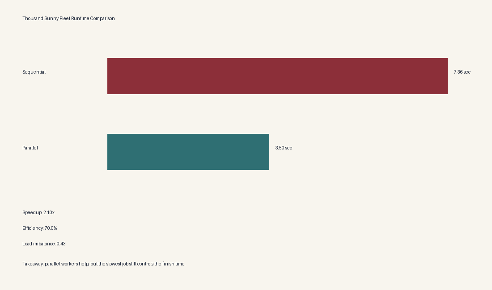
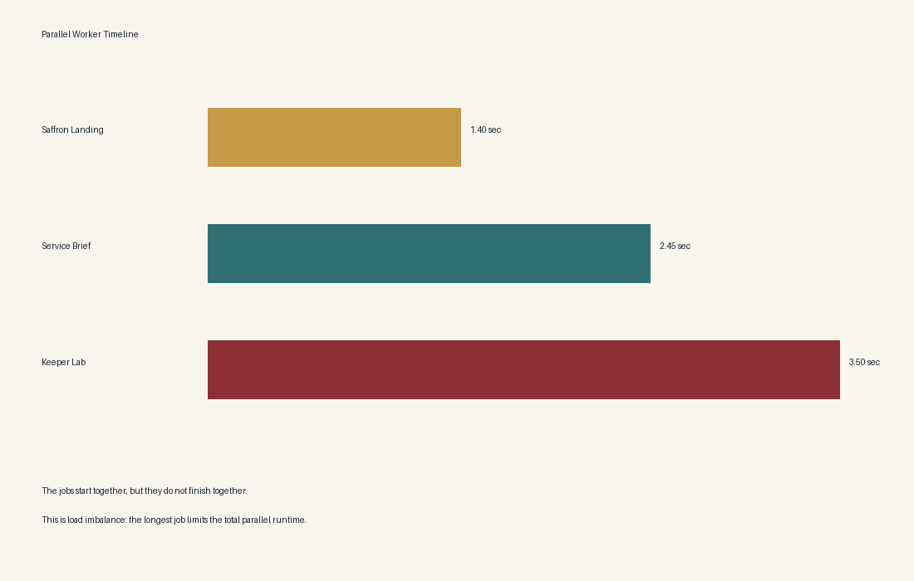
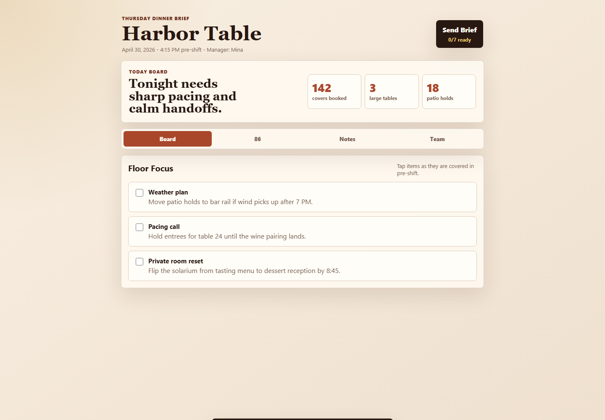
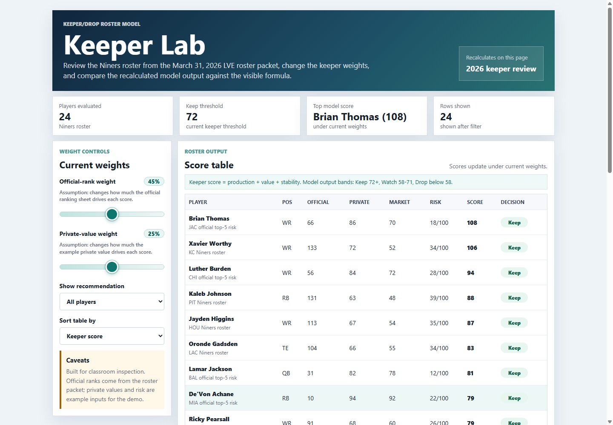

# Project Report: Thousand Sunny Fleet

## Overview

For my final project, I implemented a small parallel scheduling experiment based on a coding framework I have been building called **Thousand Sunny Fleet**.

In the framework, each software project is treated like a "ship." A ship has its own job, output, and runtime. For this project, I modeled three ships as independent workers and compared sequential execution against parallel execution.

The main question was:

> If multiple independent coding jobs can be run at the same time, how much faster is that than running them one by one?

## Why This Fits High Performance Computing

This project uses multiple class concepts.

### Parallel Programming

Each ship is an independent unit of work. In the parallel version, all three ships are launched at the same time using Python's `ThreadPoolExecutor`.

This is similar to an embarrassingly parallel workload because the jobs do not depend on each other.

### HPC Scaling

The experiment measures whether adding workers improves total runtime.

I used the standard speedup and efficiency formulas:

```text
Speedup = Sequential Time / Parallel Time
Efficiency = Speedup / Number of Workers
```

### Load Imbalance

The three jobs intentionally have different sizes. The simple website is smaller, the interactive app is medium-sized, and the analytical model is the largest.

That means the parallel run is limited by the slowest worker. This was the most important result for me because it shows why parallel systems do not always scale perfectly.

## Workloads

| Worker | Project | What it represents |
|---|---|---|
| Saffron Landing | Simple restaurant website | A low-complexity static site |
| Service Brief | Manager shift brief app | A medium-complexity interactive app |
| Keeper Lab | Analytical keeper/drop model | A higher-complexity formula and data tool |

I also included website screenshots because the assignment asked for relevant output or screenshots. The screenshots show the kind of visible products the fleet was modeling.

## Results

The generated run produced this result:

| Metric | Value |
|---|---:|
| Workers | 3 |
| Sequential time | 7.36 sec |
| Parallel time | 3.50 sec |
| Speedup | 2.10x |
| Efficiency | 70.0% |
| Load imbalance | 0.43 |
| Slowest worker | Keeper Lab |

## Interpretation

The parallel version was clearly faster than the sequential version. Instead of waiting for each ship to finish before starting the next one, the workers were able to make progress at the same time.

However, the speedup was not perfect. With three workers, perfect scaling would be close to 3x. The actual speedup was about 2.10x. The reason is that the workers did not all have the same amount of work.

The Keeper Lab worker took the longest, so even after the easier jobs finished, the total parallel run still had to wait for the analytical workload. That is load imbalance.

## What Worked

- The program successfully ran both sequential and parallel versions.
- It generated a CSV of timing data.
- It generated a runtime comparison chart.
- It generated a worker timeline.
- It showed real speedup from parallel execution.
- It also showed why scaling is not perfect.

## Challenges

The biggest challenge was making the project simple enough to explain clearly while still connecting it to real HPC ideas.

At first, I was thinking about the project mostly as an AI coding tool. But the more useful way to frame it for this class was as a scheduling and scaling experiment:

```text
jobs -> workers -> runtime -> speedup -> efficiency -> bottlenecks
```

That made the HPC connection much clearer.

## Relevant Screenshots and Output

The project includes:

- `outputs/runtime_chart.png`
- `outputs/worker_timeline.png`
- `outputs/results.csv`
- `outputs/run_summary.md`
- `outputs/website_screenshots/01-saffron-desktop.png`
- `outputs/website_screenshots/02-saffron-mobile.png`
- `outputs/website_screenshots/03-service-brief-desktop.png`
- `outputs/website_screenshots/04-service-brief-mobile.png`
- `outputs/website_screenshots/05-keeper-lab-desktop.png`
- `outputs/website_screenshots/06-keeper-lab-mobile.png`

### Runtime Chart



### Worker Timeline



### Example Website Outputs

These screenshots are the visible outputs from the three simulated coding workloads.






## What I Learned

The main thing I learned is that AI coding work can be viewed as a parallel computing workload. If the jobs are independent, parallel execution can improve throughput. But the same HPC issues still show up: overhead, uneven task sizes, and bottlenecks.

This project made the class concepts feel more concrete because I was able to apply them to something I am personally interested in building.
