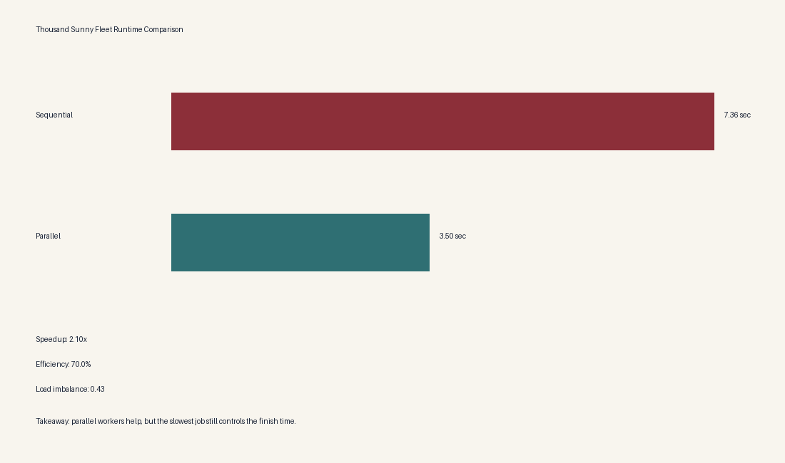
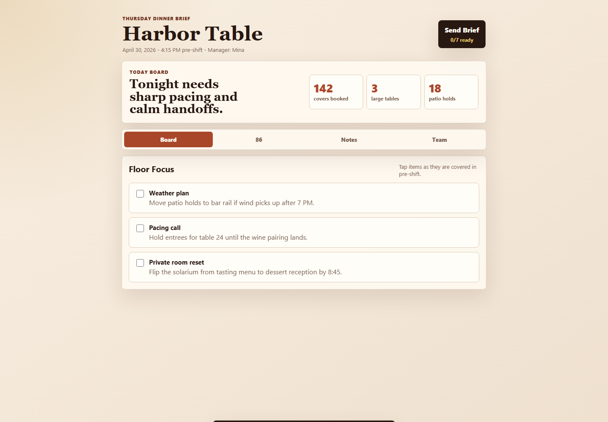
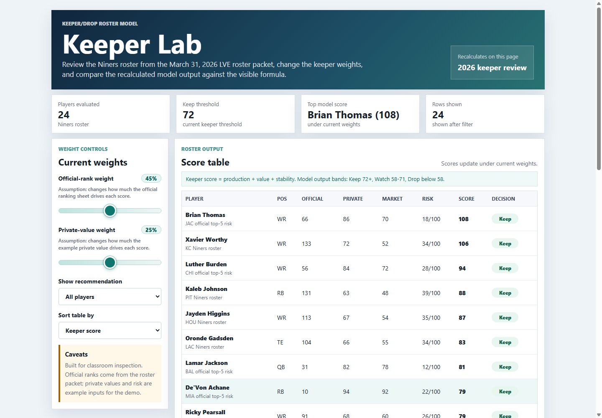

# Thousand Sunny Fleet

Final project for CSCI 494 / High Performance Computing.

## Project Summary

For my final project, I built a small Python experiment based on a local coding framework I have been working on called **Thousand Sunny Fleet**.

The idea is that each software project is treated like a "ship." Each ship has its own task, output, and runtime. The experiment compares what happens when three independent coding-style workloads run one after another versus when they run at the same time as parallel workers.

The main question I wanted to test was:

> Can independent AI coding workloads finish faster when they are scheduled in parallel, and what bottlenecks show up as the jobs become different sizes?

## Course Concepts Used

This project uses three major ideas from class:

- **Parallel programming:** the jobs can run at the same time using Python worker threads.
- **HPC scaling:** I compare sequential runtime to parallel wall-clock runtime.
- **Load imbalance:** the longest worker controls the final parallel runtime, even if the other workers finish early.

## What I Implemented

The code simulates three different coding workloads:

| Worker | Example project | Complexity |
|---|---|---|
| Saffron Landing | Simple restaurant landing page | Low |
| Service Brief | Interactive manager shift brief app | Medium |
| Keeper Lab | Analytical keeper/drop model | Higher |

The script runs the same jobs two ways:

1. **Sequential:** one worker after another.
2. **Parallel:** all workers launched together.

Then it generates timing output, charts, and a short summary.

## Results

From the generated run:

| Metric | Result |
|---|---:|
| Workers | 3 |
| Sequential time | 7.36 sec |
| Parallel time | 3.50 sec |
| Speedup | 2.10x |
| Efficiency | 70.0% |
| Load imbalance | 0.43 |
| Slowest worker | Keeper Lab |

The parallel run was faster, but it was not perfect 3x scaling. The main reason is load imbalance: the analytical worker had more work, so it became the bottleneck.

## Relevant Screenshots

The `outputs/website_screenshots/` folder includes screenshots of the three example websites/tools used as the visible outputs for the experiment:

- `01-saffron-desktop.png` and `02-saffron-mobile.png`
- `03-service-brief-desktop.png` and `04-service-brief-mobile.png`
- `05-keeper-lab-desktop.png` and `06-keeper-lab-mobile.png`

There are also generated HPC output images:

- `outputs/runtime_chart.png`
- `outputs/worker_timeline.png`

Preview examples:








## Files To Review

```text
src/thousand_sunny_fleet.py
PROJECT_REPORT.md
outputs/run_summary.md
outputs/results.csv
outputs/runtime_chart.png
outputs/worker_timeline.png
outputs/website_screenshots/
```

## How To Run

From the project folder:

```powershell
.\run_project.ps1
```

Or directly with Python:

```powershell
python src/thousand_sunny_fleet.py
```

The script regenerates the output files in `outputs/`.

## What I Learned

This helped me understand parallel scheduling in a way that felt connected to something I actually care about. Parallel workers can improve throughput, but the system still has the same problems we talked about in HPC: overhead, uneven workloads, bottlenecks, and the slowest worker limiting the whole run.
